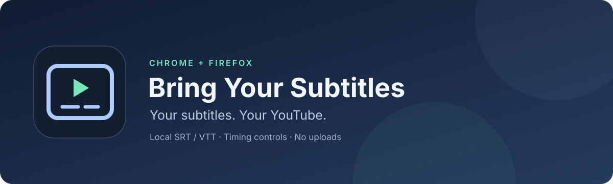

# Bring Your Subtitles

[](https://github.com/HN026/bring-your-subtitles/actions/workflows/checks.yml)
[](LICENSE)
[](https://github.com/HN026/bring-your-subtitles/releases/tag/v0.1.0)

Watch a YouTube video with a subtitle file you already have. Bring Your Subtitles adds your local **SRT or VTT** file directly over the video, with controls for timing, size and position.

**[Download v0.1.0](https://github.com/HN026/bring-your-subtitles/releases/download/v0.1.0/bring-your-subtitles-0.1.0.zip)** · [Report a bug](https://github.com/HN026/bring-your-subtitles/issues) · [Validation status](VALIDATION.md)

No build step, account, server, API key or runtime dependencies. Subtitle files stay in the current tab; the extension makes no network requests.

> **Prototype:** automated controlled-player checks pass in Chrome and Firefox. Installation and playback against live YouTube still need final acceptance. This release is not in either browser's extension store.

## What it does

| Feature | Included |
| --- | --- |
| Local SRT / VTT import | UTF-8 files up to 5 MB |
| Timing controls | Delay or advance in seconds |
| Appearance | Text size and height above the bottom |
| Playback sync | Uses the video clock for seeking and playback speed |
| Navigation | Clears the old file when a different video opens |
| Subtitle websites | Download a file yourself, then import it |

## Quick test

Load the extension using the steps below, open a regular YouTube video and choose [`examples/demo.srt`](examples/demo.srt). At **2 seconds**, you should see **“Your subtitles, on YouTube.”** Try the delay controls, close the panel, and check fullscreen.

## Install in Chrome

1. Open `chrome://extensions` and enable **Developer mode**.
2. [Download the release ZIP](https://github.com/HN026/bring-your-subtitles/releases/tag/v0.1.0) and unzip it.
3. Click **Load unpacked** and select the unzipped folder containing `manifest.json`. If using a source checkout, select its `extension` directory.
4. Open a video on `https://www.youtube.com`, then click **Bring Your Subtitles** in the extensions menu (pin it for easy access).
5. Click **Choose SRT or VTT file** in the video player.

## Install in Firefox

Requires desktop Firefox 140 or newer.

1. Open `about:debugging#/runtime/this-firefox`.
2. Choose **Load Temporary Add-on** and select the downloaded release ZIP, or `extension/manifest.json` from a source checkout.
3. Open a YouTube video, click the extension icon, and choose your subtitle file.

Firefox removes temporary add-ons when it restarts. Permanent installation in standard Firefox requires a Mozilla-signed extension; this prototype has not been submitted to either browser's store.

## Use

- Import a UTF-8 `.srt` or `.vtt` file up to 5 MB. Files downloaded from subtitle sites work the same way: download, unzip if necessary, then choose the subtitle file.
- **Delay:** positive seconds show subtitles later; negative seconds show them earlier. Buttons change delay by half a second.
- Set text size and height above the bottom of the player.
- Close the panel to watch; click the extension icon to reopen it.
- Subtitles follow the video's playback time when pausing, seeking or changing playback speed. The overlay sits inside YouTube's player for fullscreen and theater mode.
- Turn off YouTube's own CC if you see two sets of captions.
- A new video clears the loaded file, including during YouTube's in-page navigation. A page refresh also clears it. Files and settings are not persisted.
- Known YouTube ad states suppress the overlay. Files must match the movie/show cut: a constant delay cannot correct missing scenes, different edits, or progressive timing drift.

## Scope and privacy

The extension only opens its controls on desktop `youtube.com` pages. Mobile YouTube, Shorts, embeds, native picture-in-picture and casting are outside this prototype's scope. VTT positioning, styling and karaoke markup are flattened to readable plain text; ASS/SSA, ZIP and image-based subtitles are unsupported.

Only `activeTab` and `scripting` permissions are requested. Access follows a click on the extension icon; there are no all-site host permissions, background worker, analytics, network requests or remote code. Subtitle files remain in the current tab's memory. YouTube's page can observe rendered caption text in the shared player DOM; this is not a private surface isolated from the site.

This version supports downloading subtitle files yourself. Searching subtitle sites, fetching URLs and automatic matching are not implemented. Those can be added as explicit provider integrations after choosing a provider and checking its API, authentication and permission requirements.

## Development and validation

Clone this repository and run commands from its root. Tests use Node.js 22+; packaging uses Python 3.10+. The extension itself needs neither runtime.

```sh
node --test tests/*.test.cjs
node --check extension/content.js
node --check extension/popup.js
python3 scripts/package.py

# macOS only, with both browsers installed:
python3 tests/check-browsers.py
```

The Python runner uses installed macOS Chrome and Firefox with disposable profiles and a loopback-only server. It runs 17 controlled-player checks per browser, including a strict Trusted Types policy where supported, file import, safe text rendering, seeking, offsets, visibility, ad suppression, sizing, reopening, replacing the video element and navigation to a different video. You can also serve this project with `python3 -m http.server --bind 127.0.0.1 8765` and visit `http://127.0.0.1:8765/tests/browser.html`. The fixture does not load a real YouTube video or exercise the browser's extension permission/injection layer.

See `VALIDATION.md` for completed checks and remaining acceptance work. `dist/bring-your-subtitles-0.1.0.zip` contains just the extension files, with `manifest.json` at the root. Unzip it before loading it unpacked in Chrome; Firefox's temporary add-on loader can use the ZIP directly.

Manual acceptance in **both** browsers: install the extension, open a regular YouTube video, import `examples/demo.srt`, seek to 2 seconds, change delay, enter fullscreen, pause/resume, and navigate to another video without reloading. Verify captions clear on the new video. YouTube player changes may require updates to the `#movie_player` selector or ad-state detection.

Implementation references: [extension scripting API](https://developer.mozilla.org/en-US/docs/Mozilla/Add-ons/WebExtensions/API/scripting/executeScript), [Chrome content scripts](https://developer.chrome.com/docs/extensions/develop/concepts/content-scripts), [Firefox data collection declaration](https://developer.mozilla.org/en-US/docs/Mozilla/Add-ons/WebExtensions/manifest.json/browser_specific_settings).

## Packaging

Run `python3 scripts/package.py` to create a reproducible extension ZIP and `dist/SHA256SUMS.txt`. Generated archives are distributed through GitHub Releases rather than committed to source. Icons can be regenerated with `python3 scripts/generate_icons.py`; both scripts use only Python's standard library.

## Contributing and license

See [CONTRIBUTING.md](CONTRIBUTING.md) and [CHANGELOG.md](CHANGELOG.md). Released under the [MIT license](LICENSE). This project is independent of YouTube and Google.
